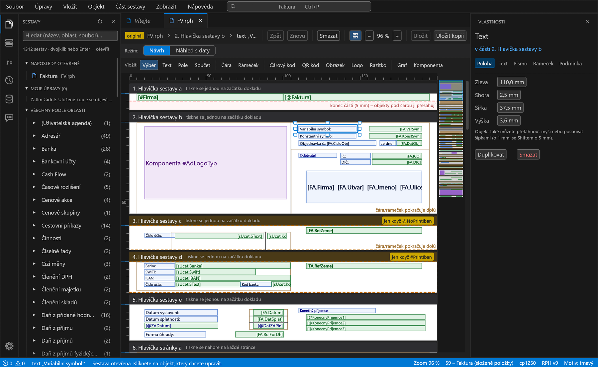
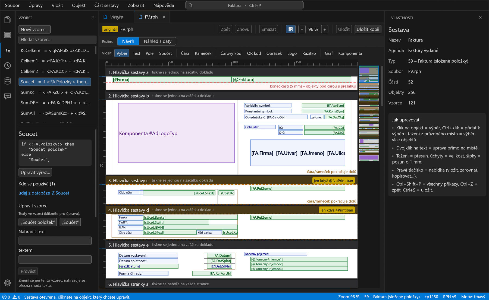
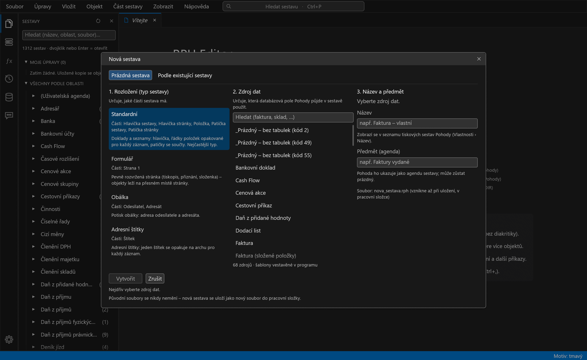
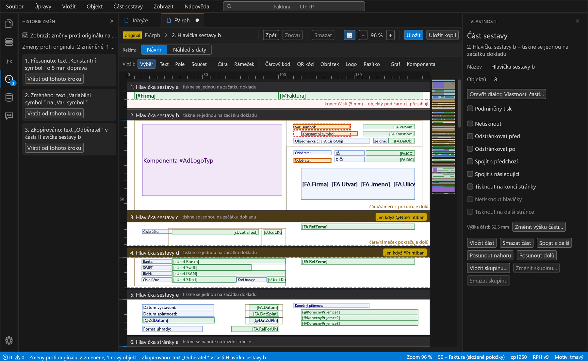
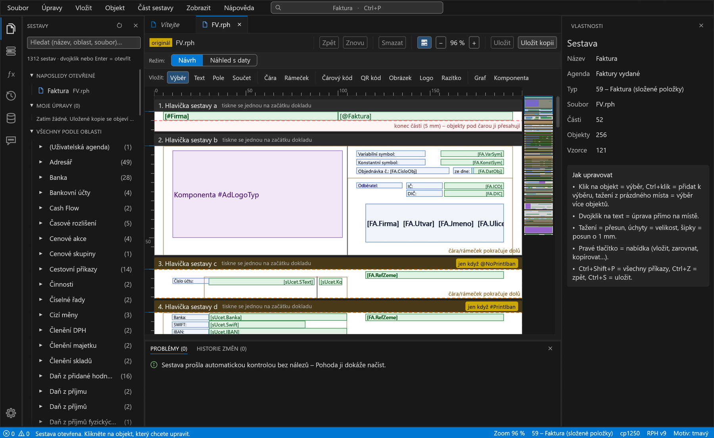
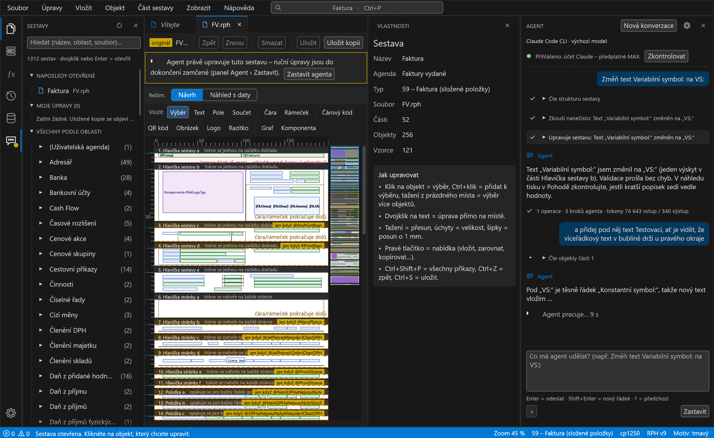
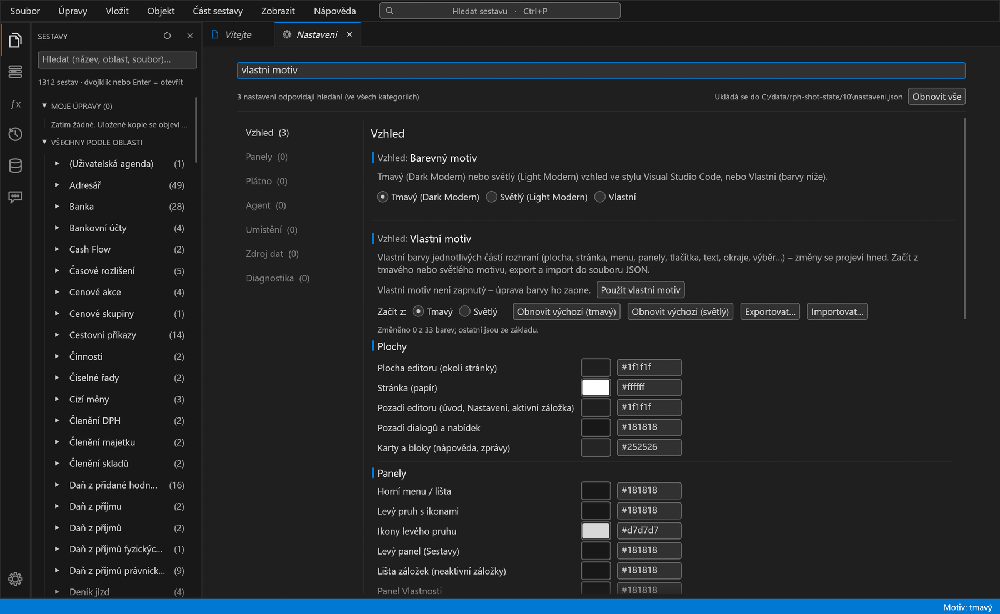
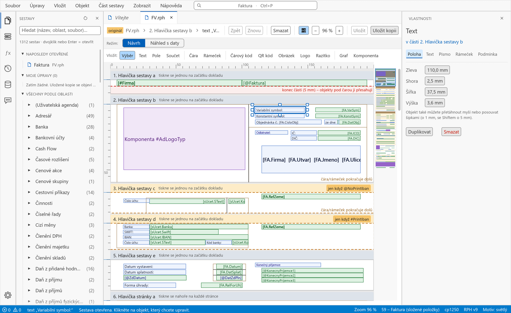
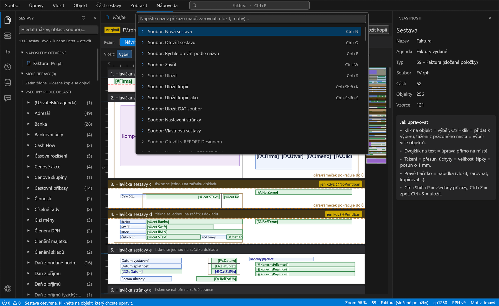
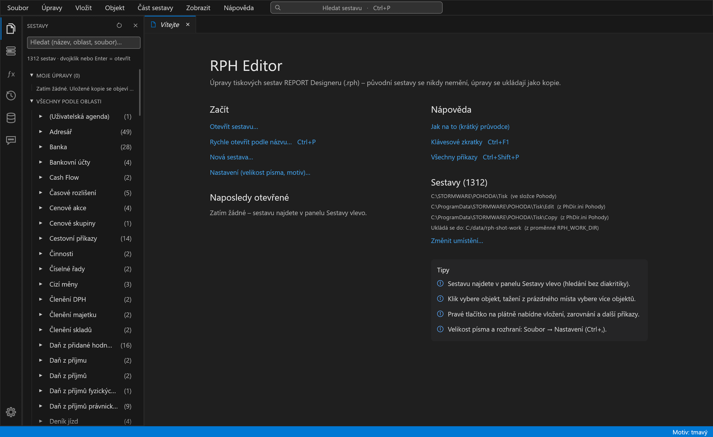

# RPH Editor – editor tiskových sestav pro Pohodu

**RPH Editor** je neoficiální program pro úpravy tiskových sestav účetního programu **POHODA** (soubory `.rph`
z REPORT Designeru). Faktury, objednávky, dodací listy, bankovní doklady a další tiskové sestavy upravujete myší přímo
na náhledu sestavy: měníte texty, posouváte a zvětšujete políčka, vkládáte nová pole, upravujete podmínky tisku
a vzorce. Původní sestavy Pohody se přitom **nikdy nemění**, úpravy se ukládají jako kopie.

Program byl vytvořen v Claude Code a naprogramován v Rustu. Aplikace je určená pro systémy Windows.



> **Stav projektu:** první veřejná verze, použitelná, ale stále vyvíjená. Přečtěte si prosím část
> [Stav projektu a omezení](#stav-projektu-a-omezení) a vždy pracujte na kopii sestavy.

## Obsah

- [Co program umí](#co-program-umí)
- [Jak to vypadá](#jak-to-vypadá)
- [Bezpečnost vašich dat](#bezpečnost-vašich-dat)
- [Systémové požadavky](#systémové-požadavky)
- [Jak začít](#jak-začít)
- [Klávesové zkratky](#klávesové-zkratky)
- [Stav projektu a omezení](#stav-projektu-a-omezení)
- [Hlášení chyb a nápadů](#hlášení-chyb-a-nápadů)
- [Právní upozornění](#právní-upozornění)

## Co program umí

### Otevírání a hledání sestav

- Panel **Sestavy** s hledáním podle názvu, oblasti nebo jména souboru (hledá se i bez diakritiky). Sestavy jsou
  seskupené podle oblasti (Faktury, Banka, Sklady, …) a nahoře je vidět **Naposledy otevřené** a **Moje úpravy**
  (vaše uložené kopie).
- **Rychlé otevření podle názvu** (Ctrl+P) a více sestav najednou v záložkách. Tečka u názvu záložky znamená neuložené změny.
- Program si **sám najde Pohodu** (instalační složku, složku `Tisk`, vaše kopie) a jen z ní čte, nic do ní nezapisuje.
  Bez nainstalované Pohody funguje dál: sestavu otevřete ze souboru nebo přidáte vlastní složku se sestavami.

### Úpravy přímo na plátně

- Sestava se zobrazuje jako **části** (hlavičky, položky, patičky) a v nich objekty: texty, údaje z databáze, součty,
  čáry, rámečky, čárové kódy, QR kódy, obrázky, loga, razítka, grafy a vložené komponenty. Barvy jednotlivých druhů
  objektů vysvětluje okno **Nápověda › Legenda barev**.
- **Výběr, přesun a změna velikosti myší**, jemný posun šipkami (o 1 mm, se Shiftem o 5 mm), výběr více objektů,
  **zarovnání**, **duplikování**, **mazání**, **kopírování a vkládání** i mezi různými sestavami a záložkami.
- **Úprava textu přímo na plátně** (dvojklik nebo F2), pravítko v milimetrech, mřížka, přibližování a **minimapa**
  celé sestavy.
- **Zpět a Znovu** (Ctrl+Z, Ctrl+Y) a **Historie změn**: každý krok má srozumitelný popis a lze se vrátit k libovolnému kroku.
- **Vložení** nového objektu (text, pole z databáze, součet, čára, rámeček, čárový kód, QR kód, obrázek, logo, razítko,
  graf, komponenta). Databázová pole vybíráte ze stromu polí podle tabulek Pohody.

### Vlastnosti objektů a částí sestavy

- Panel **Vlastnosti** vybraného objektu: poloha a rozměry, text, písmo, rámeček a čára, formát čísel a dat,
  zalamování a zarovnání textu, podmínka tisku objektu a další volby podle druhu objektu.
- **Části sestavy**: název, podmínky tisku (např. „jen když je plátce DPH“), výška části, přidání, smazání, přesun,
  **skupiny** a příznaky jako „nerozdělovat na dvě stránky“.
- **Nastavení stránky** (formát papíru, okraje, obálky, adresní štítky) a **Vlastnosti sestavy** (název, autor a další údaje).

### Vzorce

- Seznam všech vzorců sestavy s hledáním, zobrazení **kde se vzorec používá**, **úprava výrazu** a **nový vzorec**,
  včetně součtových vzorců. Zápis výrazů a funkce odpovídají REPORT Designeru; editor výraz před uložením zkontroluje
  stejně jako tlačítko Test v Designeru a chybu ukáže česky s řádkem a sloupcem.



### Nová sestava

- Dialog **Nová sestava** nabízí rozložení (standardní, formulář, obálka, adresní štítky) a **zdroj dat** z desítek
  agend Pohody. **Šablony jsou součástí programu**, takže novou sestavu lze založit i bez nainstalované Pohody.
- Novou sestavu lze založit i **podle existující sestavy**.



### Zdroj dat (.dat) a SQL Server

- Editor zdroje dat (`.dat`) sestavy: popis tabulek nebo vlastní **SQL dotaz**, kontrola dotazu a jeho vyzkoušení
  nad databází.
- Připojení k **SQL Serveru Pohody E1** (jen pro čtení). Každý dotaz se před odesláním zkontroluje a povolen je pouze
  jediný příkaz SELECT.

### Náhled s daty

- Přepínač **Návrh | Náhled s daty** (F5) ukáže sestavu s údaji skutečného dokladu z databáze Pohody, i s neuloženými
  úpravami. Náhled se po každé úpravě sám překreslí.
- Zdrojem dat je **databáze Pohody** (Access `.mdb`, program vždy čte jen dočasnou kopii) nebo **SQL Server**. Náhled
  vykreslí čárové kódy, QR kódy, obrázky, grafy a skupiny, ukáže chyby a varování vzorců, nabízí výběr dokladu s hledáním
  a umí uložit náhled jako SVG.
- Bez databáze se zobrazí **náhled bez dat** (rozložení částí a statické texty).

### Změny proti originálu

- Zapnutím zobrazení **změn proti originálu** se na plátně zvýrazní nové a změněné objekty (oranžově) a původní poloha
  smazaných objektů. Ve stavovém řádku je souhrn změn. Zachytí změny textu, polohy i vlastností.



### Kontrola sestavy

- Panel **Problémy** sestavu průběžně kontroluje a kliknutím na nález přejdete na dotčený objekt. Pokud by úprava mohla
  sestavu poškodit tak, že by ji Pohoda nenačetla, program ji **neprovede** a česky vysvětlí proč.



### Agent: úpravy pomocí umělé inteligence (volitelné)

- Panel **Agent** je chat, kam česky napíšete, co se má v otevřené sestavě změnit („Změň text Variabilní symbol: na VS:“,
  „Vysvětli podmínky tisku této části“, „Zkontroluj sestavu a navrhni opravy“). Agent změny provede nástroji editoru
  a celé zadání je jeden krok historie, který lze vrátit jedním Ctrl+Z.
- Agent používá **vaše vlastní přihlášení** k programu **Claude Code CLI** nebo **Codex CLI**. RPH Editor žádná hesla
  ani klíče neukládá. Bez agenta funguje všechno ostatní.
- K zadání lze **přiložit soubory**: zdroj dat `.dat`, jinou sestavu `.rph` (ke čtení), textové soubory a obrázek
  nebo PDF jako předlohu.
- **Změny textů, vlastností sestavy a zdroje dat agent nejdřív nabídne k potvrzení.** Agent smí pracovat jen
  s nástroji editoru, ne se soubory na disku.
- Pro vlastní AI klienty je součástí také **server MCP** (`rph-mcp`) se stejnými bezpečnostními pravidly.
  Postup instalace je [níže](#server-mcp-rph-mcp-pro-vlastní-ai-klienty).



#### Server MCP (`rph-mcp`) pro vlastní AI klienty

Panel Agent v editoru si MCP server spouští sám a nic nastavovat nemusíte. Chcete-li sestavy upravovat v **jiném AI
klientu** (Claude Code, Claude Desktop, Codex CLI, Cursor, VS Code, Gemini CLI a další), zaregistrujete `rph-mcp.exe`
v něm. Server mluví standardním protokolem **MCP přes stdio**, takže funguje v každém klientu, který takové servery umí.

**Co je potřeba**

- soubor `rph-mcp.exe` (je ve vydání programu vedle `rph-gui.exe`) uložený na pevné místo, např.
  `C:\Programy\RphEditor\rph-mcp.exe`,
- **pracovní složku** pro nové sestavy (`RPH_WORK_DIR`) – jediné místo, kam server smí zapisovat. Pro Pohodu je to
  typicky `C:\ProgramData\STORMWARE\POHODA\Tisk\Copy`, takže uložené sestavy uvidíte rovnou v Pohodě. Složka s názvem `Tisk`
  není jako pracovní složka povolena,
- volitelně **složky ke čtení** (`RPH_READ_ROOTS`), např. `C:\ProgramData\STORMWARE\POHODA\Tisk` s originály Pohody.
  Více složek oddělte znakem `|`. Pracovní složka je čitelná vždy.

Cesty v příkladech upravte podle svého počítače. Po registraci klienta **restartujte** (nebo v něm obnovte seznam serverů)
a zkuste zadání např. „Vypiš sestavy v pracovní složce.“

<details>
<summary><b>Claude Code</b> (příkazový řádek)</summary>

```powershell
claude mcp add rph --scope user `
  --env RPH_WORK_DIR=C:\ProgramData\STORMWARE\POHODA\Tisk\Copy `
  --env "RPH_READ_ROOTS=C:\ProgramData\STORMWARE\POHODA\Tisk" `
  -- C:\Programy\RphEditor\rph-mcp.exe
```

- Bez `--scope user` se server zaregistruje jen pro aktuální projekt (složku).
- Hodnotu `RPH_READ_ROOTS` s více složkami (`C:\a|D:\b`) dejte do uvozovek, jinak ji PowerShell i cmd vezmou jako rouru.
- Kontrola: `claude mcp list`, v samotném Claude Code příkaz `/mcp`.

</details>

<details>
<summary><b>Claude Desktop</b></summary>

V aplikaci **Nastavení › Vývojář › Upravit konfiguraci** otevřete soubor `claude_desktop_config.json`
(obvykle `%APPDATA%\Claude\claude_desktop_config.json`) a přidejte server do `mcpServers`:

```json
{
  "mcpServers": {
    "rph": {
      "command": "C:\\Programy\\RphEditor\\rph-mcp.exe",
      "env": {
        "RPH_WORK_DIR": "C:\\ProgramData\\STORMWARE\\POHODA\\Tisk\\Copy",
        "RPH_READ_ROOTS": "C:\\ProgramData\\STORMWARE\\POHODA\\Tisk"
      }
    }
  }
}
```

V JSON je nutné zdvojit zpětná lomítka. Potom Claude Desktop **úplně ukončete** (i z oznamovací oblasti) a spusťte znovu.

</details>

<details>
<summary><b>Codex CLI</b></summary>

```powershell
codex mcp add rph `
  --env RPH_WORK_DIR=C:\ProgramData\STORMWARE\POHODA\Tisk\Copy `
  --env "RPH_READ_ROOTS=C:\ProgramData\STORMWARE\POHODA\Tisk" `
  -- C:\Programy\RphEditor\rph-mcp.exe
```

Nebo ručně v souboru `%USERPROFILE%\.codex\config.toml` (v řetězcích TOML se používají jednoduché apostrofy nebo
zdvojená lomítka):

```toml
[mcp_servers.rph]
command = 'C:\Programy\RphEditor\rph-mcp.exe'

[mcp_servers.rph.env]
RPH_WORK_DIR = 'C:\ProgramData\STORMWARE\POHODA\Tisk\Copy'
RPH_READ_ROOTS = 'C:\ProgramData\STORMWARE\POHODA\Tisk'
```

Kontrola: `codex mcp list`, v interaktivním Codexu příkaz `/mcp`.

</details>

<details>
<summary><b>Cursor, Gemini CLI, Cline a další klienty s <code>mcpServers</code></b></summary>

Většina dalších klientů používá stejný zápis jako Claude Desktop (blok `mcpServers` výše). Liší se jen umístěním souboru,
např. Cursor `%USERPROFILE%\.cursor\mcp.json`, Gemini CLI `%USERPROFILE%\.gemini\settings.json`. Přesné místo
ověřte v dokumentaci svého klienta, může se mezi verzemi lišit.

</details>

<details>
<summary><b>Visual Studio Code (GitHub Copilot)</b></summary>

Příkazem **MCP: Add Server** nebo ručně v souboru `.vscode\mcp.json` ve složce projektu (nebo v uživatelském `mcp.json`).
Tady se blok jmenuje `servers`:

```json
{
  "servers": {
    "rph": {
      "type": "stdio",
      "command": "C:\\Programy\\RphEditor\\rph-mcp.exe",
      "env": {
        "RPH_WORK_DIR": "C:\\ProgramData\\STORMWARE\\POHODA\\Tisk\\Copy",
        "RPH_READ_ROOTS": "C:\\ProgramData\\STORMWARE\\POHODA\\Tisk"
      }
    }
  }
}
```

</details>

**Co server nabízí.** Nástroje pro výpis a prohlížení sestav, kontrolu a porovnání dvou sestav, úpravy pomocí
pojmenovaných operací (s možností nejdřív zkusit změnu naprázdno), založení nové sestavy ze šablony, seznam polí
databáze a kontrolu a úpravy zdroje dat (`.dat`). Pracuje s **uloženými soubory** `.rph`, ne s dokumentem otevřeným v okně
editoru (to dělá panel Agent).

**Bezpečnostní pravidla** platí stejně jako v editoru a server je vynucuje sám, ne jen „prosbou“ k AI:

- čte jen z `RPH_READ_ROOTS` a z pracovní složky, ostatní cesty (včetně síťových `\\server\sdílená`) odmítne,
- zapisuje **jen nové soubory `*.rph`** do pracovní složky, nikdy nepřepisuje existující soubor ani nezapisuje do složky `Tisk`,
- texty v sestavách a zdroji dat bere jako data, ne jako pokyny,
- úprava, po které by Pohoda sestavu nenačetla, se neprovede.

Po úpravě sestavu vždy otevřete v Pohodě a vyzkoušejte tiskem. AI klient je externí program a to, co mu zadáte,
zpracovává jeho poskytovatel podle svých podmínek.

### Vzhled, pohodlí a přístupnost

- **Tmavý, světlý i vlastní motiv** (jednotlivé barvy lze nastavit, export a import motivu do souboru), barva titulkové
  lišty okna (Windows 11), velikost rozhraní a písma.
- **Paleta příkazů** (Ctrl+Shift+P) se všemi příkazy, kontextová **nápověda F1** k aktuálnímu oknu, krátký průvodce
  a přehled klávesových zkratek (Ctrl+F1).
- Ovládání z klávesnice, viditelný fokus, dostatečně velké cíle pro kliknutí a kontrola kontrastu textu v motivech.



## Jak to vypadá

| | |
|---|---|
|  **Světlý motiv** s vybraným objektem a panelem Vlastnosti |  **Paleta příkazů** (Ctrl+Shift+P) |
|  **Úvodní obrazovka** |  **Nová sestava** z vestavěných šablon |

## Bezpečnost vašich dat

- **Původní sestavy se nikdy nepřepisují.** První uložení vytvoří novou kopii v pracovní složce (výchozí je `Tisk\Copy`
  Pohody, jinak `Dokumenty\RPH Editor`), další Uložit přepisuje jen tuto vaši kopii. Do složky `Tisk` s originály
  program nezapisuje.
- **Zápis je atomický**: soubor se zapíše do dočasného souboru a teprve potom nahradí cíl, takže pád programu nebo
  odpojení disku sestavu nepoškodí. Program pozná, že se soubor mezitím změnil na disku (např. v Designeru), a zeptá se.
- **Obnova po pádu**: neuložené změny se po chvíli nečinnosti (interval lze nastavit) průběžně zálohují a po neočekávaném
  ukončení program nabídne jejich obnovení. Záloha se po uložení smaže.
- Databáze Pohody se **nikdy neotevírají na místě**. Program čte jen dočasnou kopii, jen pro čtení, a po načtení ji smaže.
- Hlášení chyb (**Nápověda › Nahlásit chybu**) se vytvoří jako soubor ZIP s **anonymizovanými** údaji (jména, e-maily,
  názvy serverů a databází), který si prohlédnete a případně pošlete sami. **Nic se neodesílá automaticky.**

## Systémové požadavky

- **Windows 10 nebo 11** (64 bit). Vývoj a testování probíhaly na Windows 11.
- **Grafika:** program kreslí přes OpenGL 2.0. Když ho počítač nemá (Vzdálená plocha bez grafické karty, virtuální stroj,
  starý ovladač), sám se znovu spustí s vykreslováním přes DirectX 12 / Vulkan, včetně softwarového adaptéru Windows.
  Ověřeno ve virtuálním stroji, na skutečné Vzdálené ploše serveru bez GPU zatím ne – pokud to u vás nefunguje, napište
  do [Issues](../../issues).
- **Pohoda není nutná.** S ní program sám najde sestavy, data a REPORT Designer. Podporovány jsou sestavy z REPORT
  Designeru Pohody verze 5.x.
- Pro **Náhled s daty** nad databází `.mdb` je potřeba ovladač ODBC pro Microsoft Access (bývá v počítači s Pohodou),
  pro SQL Server ovladač ODBC pro SQL Server (stačí starý ovladač Windows „SQL Server“, pro šifrované spojení
  „ODBC Driver 18 for SQL Server“).
- Volitelně pro **Agenta**: nainstalovaný a přihlášený Claude Code CLI nebo Codex CLI.
- Volitelně pro příkazy **Otevřít v REPORT Designeru** a normalizaci starších sestav: nainstalovaná Pohoda
  s REPORT Designerem (a pro normalizaci také Python). Vše ostatní funguje i bez nich.

## Jak začít

Program nevyžaduje instalaci, stačí složka s `rph-gui.exe`. Nastavení se ukládá do `%APPDATA%\rph-gui\nastaveni.json`.

> **Stažení:** poslední verzi najdete v sekci **[Releases](../../releases/latest)** tohoto repozitáře
> (soubor `RphEditor-0.1.1.zip`, stačí rozbalit a spustit `rph-gui.exe`). Program není digitálně podepsaný, takže ho
> Windows při prvním spuštění může označit jako neznámý (**Další informace › Přesto spustit**).

1. Spusťte `rph-gui.exe`. Při prvním spuštění se zobrazí krátký průvodce (znovu ho otevřete v **Nápověda › Jak na to**).
2. Sestavu najdete v panelu **Sestavy** vlevo, přes Ctrl+P, nebo ji otevřete ze souboru (**Soubor › Otevřít sestavu**).
3. Klikněte na objekt, který chcete upravit. Dvojklik upraví text přímo na plátně, tažení objekt přesune.
4. Změny uložíte tlačítkem **Uložit** (Ctrl+S). U originálu Pohody se vytvoří nová kopie, původní sestava zůstane
   beze změny. Kopie uložená do `Tisk\Copy` se v Pohodě nabídne mezi sestavami k tisku.
5. **Před nasazením upravenou sestavu vždy vyzkoušejte tiskem v Pohodě.**

## Klávesové zkratky

| Zkratka | Akce |
|---|---|
| Ctrl+P | Rychle otevřít sestavu podle názvu |
| Ctrl+O / Ctrl+N | Otevřít sestavu / nová sestava |
| Ctrl+S | Uložit (u originálu vytvoří kopii) |
| Ctrl+Shift+K / Ctrl+Shift+S | Uložit kopii / Uložit kopii jako… |
| Ctrl+Z / Ctrl+Y | Zpět / Znovu |
| Ctrl+C / Ctrl+X / Ctrl+V | Kopírovat / vyjmout / vložit (i do jiné sestavy) |
| Ctrl+D / Delete | Duplikovat / smazat vybrané objekty |
| F2 nebo dvojklik | Upravit text přímo na plátně |
| F5 | Přepnout Návrh a Náhled s daty |
| Ctrl+0 | Přizpůsobit sestavu šířce okna |
| Ctrl+W / Ctrl+Tab | Zavřít záložku / přepnout záložku |
| Ctrl+Shift+P | Paleta všech příkazů |
| F1 / Ctrl+F1 | Nápověda k aktuálnímu oknu / přehled zkratek |
| Ctrl+Shift+A | Panel Agent |
| Ctrl+Shift+M | Panel Problémy |
| Ctrl+Shift+D | Panel Zdroj dat |

## Stav projektu a omezení

RPH Editor je nový program a je poctivé říct, kde jsou jeho hranice:

- Úpravy se zapisují způsobem, který odpovídá formátu REPORT Designeru, a čtení i zápis jsou ověřené automatickými
  testy na velkém množství sestav z instalace Pohody. Tisk upravených sestav v Pohodě byl ověřen u části funkcí
  (např. texty, přesuny, vzorce, nové sestavy ze šablon). U **čárových kódů, obrázků, razítek a grafů** doporučujeme
  výsledek v Pohodě zvlášť zkontrolovat.
- Co program **neumí bezpečně zapsat**, zůstává šedé s vysvětlením. Takové úpravy provedete v REPORT Designeru.
- Sestavy uložené **starší verzí** Designeru se někdy musí nejdřív normalizovat v REPORT Designeru, program na to upozorní.
- Funkce Agent závisí na externím programu (Claude Code CLI nebo Codex CLI), jeho verzi a vašem předplatném.
- Program se vyvíjí. Zálohujte si své sestavy a před ostrým použitím vše vyzkoušejte.

## Hlášení chyb a nápadů

Chyby a nápady můžete zakládat v sekci **[Issues](../../issues)**. Pokud program vytvořil hlášení o chybě
(Nápověda › Nahlásit chybu), přiložte jen to, co jste si prohlédli a co chcete sdílet. Odpověď ani opravu nelze
zaručit.

## Právní upozornění

- RPH Editor je **neoficiální** program. Není vytvořen, schválen ani podporován společností **STORMWARE s.r.o.**
- **POHODA** a **REPORT Designer** jsou ochranné známky nebo názvy produktů společnosti STORMWARE s.r.o. Jsou zde
  použity pouze k popisu kompatibility programu. Ukázky na snímcích obrazovky zobrazují standardní tiskovou sestavu
  Pohody otevřenou v tomto programu.
- Program je poskytován **„tak, jak je“**, bez jakékoli záruky. Používáte ho na vlastní odpovědnost, upravené sestavy
  před nasazením vždy zkontrolujte.
- **Licence:** program je **freeware, bez záruky**. Můžete ho zdarma používat i ve firmě a šířit v nezměněné podobě,
  nesmíte ho prodávat, upravovat ani zpětně analyzovat. Úplné znění je v souboru [LICENCE.txt](LICENCE.txt).
- Zdrojový kód není zveřejněn.

Autor: [@OndrejKozacik](https://github.com/OndrejKozacik)
